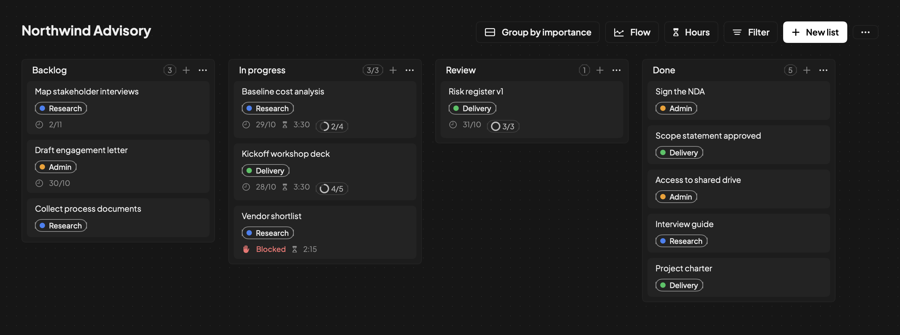
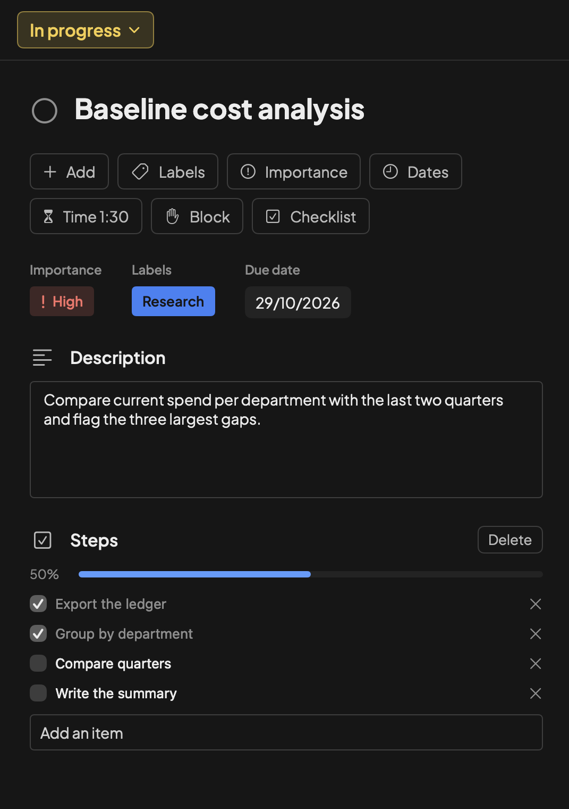
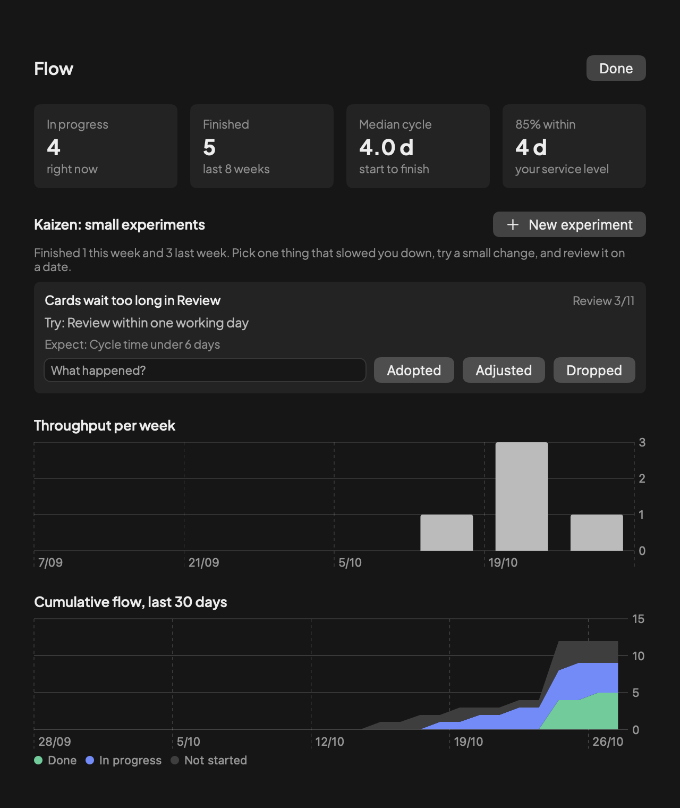
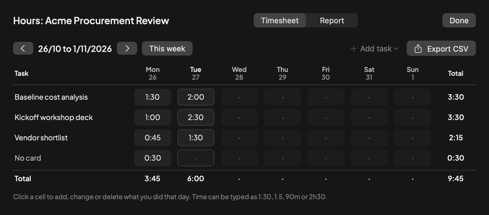
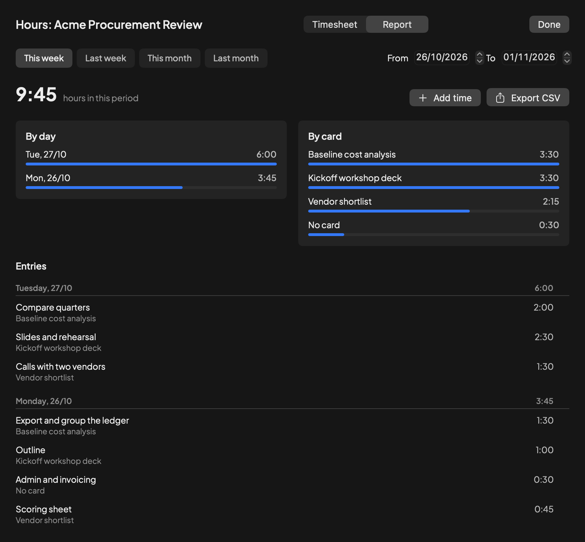

<div align="center">

<picture>
  <source media="(prefers-color-scheme: dark)" srcset="Resources/Brand/boto-logo-dark-mode.png">
  
</picture>

# Boto

**Um app de Kanban pessoal para macOS, com métricas de fluxo, folha de horas e Apple Calendar.**

Local-first. Nativo. Feito com Swift, SwiftUI e SwiftData.

[](https://github.com/paulo-amaral/boto/actions/workflows/ci.yml)
[](https://github.com/paulo-amaral/boto/actions/workflows/codeql.yml)
[](https://github.com/paulo-amaral/boto/releases)
[](LICENSE)
[](https://github.com/paulo-amaral/boto/commits/main)
[](https://github.com/paulo-amaral/boto/issues)
[](https://github.com/paulo-amaral/boto/stargazers)


[](CONTRIBUTING.md)
[](https://github.com/paulo-amaral/boto/blob/main/.github/dependabot.yml)
[](CHANGELOG.md)
[](https://semver.org/)

[Baixar](https://github.com/paulo-amaral/boto/releases) · [Compilar](#compilar) · [Segurança](SECURITY.md) · [English](README.md)

</div>

O Boto é um quadro Kanban para uma pessoa. Projetos têm quadros, quadros têm listas e listas têm cartões. Os dados ficam no seu Mac, em um arquivo seu, com backup diário. Foi feito para consultores que precisam ver o que está em andamento, quanto o trabalho leva de fato e quantas horas foram para cada tarefa.

## Capturas de tela

Todas as capturas usam dados fictícios.

### Quadro

<p align="center">
  
  <br><sub>Listas com etiquetas, datas, um cartão bloqueado e limite de WIP.</sub>
</p>

### Cartão e fluxo

<table align="center">
  <tr>
    <td align="center" width="50%">
      
      <br><sub>Um cartão: importância, etiqueta, data, descrição e passos.</sub>
    </td>
    <td align="center" width="50%">
      
      <br><sub>Fluxo: tempo de ciclo, experimento Kaizen, vazão e fluxo acumulado.</sub>
    </td>
  </tr>
</table>

### Horas

<p align="center">
  
  <br><sub>Folha de horas semanal por tarefa e dia.</sub>
</p>

<p align="center">
  
  <br><sub>Relatório por período, por dia, por cartão e por lançamento.</sub>
</p>

## Recursos

- **Notas:** post-its coloridos em cada projeto, para anotações que não são tarefas.
- **Ícones:** escolha o ícone de cada projeto entre cerca de 1.900 do Lucide, com busca por nome ou tema.
- **Quadros:** projetos, quadros, listas e cartões com etiquetas, cores, checklists, datas e descrição em Markdown. Arrastar e soltar, seleção múltipla, arquivar, agrupar por importância, filtros, busca e paleta de comandos.
- **Referências:** arquivos e pastas locais, notas do Obsidian, issues e pull requests do GitHub e mensagens do Mail. O Boto guarda apenas ponteiros e nunca copia nem altera seus arquivos.
- **Importação:** Trello e GitHub.
- **Fluxo e Kaizen:** limite de WIP e política por lista, cartão bloqueado com motivo, vazão, idade do item, tempo de ciclo, expectativa de nível de serviço (percentil 85) e fluxo acumulado. Registro Kaizen com problema, experimento e revisão em data marcada.
- **Horas:** cronômetro no cartão ou lançamento manual, folha de horas semanal por tarefa e dia, relatório por período e exportação em CSV, com proteção contra fórmulas.
- **Apple Calendar:** a data do cartão vira evento em um calendário chamado Boto, de dia inteiro ou com hora, com o alerta que você escolher. Concluir ou arquivar o cartão remove o evento.
- **Seus dados:** em `~/Library/Application Support/Boto/`, com backups diários em `Backups/`. O único código de rede é a integração com o GitHub.

## Instalar

1. Baixe `Boto-<versão>.zip` em [Releases](https://github.com/paulo-amaral/boto/releases) e descompacte.
2. Mova `Boto.app` para `/Applications`.
3. O app tem assinatura ad hoc e não é notarizado. Na primeira abertura, clique com o botão direito e escolha Abrir. Se o macOS ainda recusar, rode `xattr -dr com.apple.quarantine /Applications/Boto.app`.

Cada release traz o checksum SHA-256 e uma atestação de proveniência. Verifique com `gh attestation verify Boto-<versão>.zip --repo paulo-amaral/boto`.

Requer macOS 14 ou superior.

## Usar o Boto com um assistente de IA (MCP)

O Boto inclui o `boto-mcp`, um servidor do [Model Context Protocol](https://modelcontextprotocol.io) que permite a um assistente, como o Claude, ler seus quadros e atualizá-los. Ele roda no seu Mac e conversa com o assistente por entrada e saída padrão. Abre o mesmo banco de dados do app.

Adicione-o às configurações de MCP do assistente, com o caminho do app instalado:

```json
{
  "mcpServers": {
    "boto": {
      "command": "/Applications/Boto.app/Contents/MacOS/boto-mcp"
    }
  }
}
```

O servidor só lê por padrão. Acrescente `"args": ["--allow-writes"]` para o assistente criar e alterar cartões.

| Leitura | Escrita (exige `--allow-writes`) |
|---|---|
| `list_projects`, `get_board`, `get_card`, `get_card_activity`, `list_labels`, `search`, `get_time_report` | `create_card`, `update_card`, `move_card`, `set_card_archived`, `duplicate_project`, `add_checklist_item`, `set_checklist_item_completed`, `log_time` |

- Não há ferramenta de exclusão. Excluir e restaurar ficam no app, em Recently deleted.
- Um cartão que está no Apple Calendar não pode ser concluído nem arquivado por aqui, porque isso remove o evento e só o app tem a permissão do calendário. Faça no app.
- Os textos têm limite de tamanho, os ids são conferidos e um argumento inválido não altera nada.
- O que uma ferramenta devolve vai para o assistente e, dele, para a empresa que opera o modelo. Mantenha o modo só-leitura padrão, ou não conecte, para quadros que você não pode compartilhar.
- Não verificado: se uma janela do Boto já aberta mostra na hora as mudanças feitas pelo assistente. Reabra o projeto se não mostrar.

## Compilar

```sh
git clone https://github.com/paulo-amaral/boto.git
cd boto
git config core.hooksPath .githooks   # varredura de segredos e checagem de Conventional Commits
swift test
./Scripts/make-app.sh
open build/Boto.app
```

## Licença

[GNU AGPL-3.0](LICENSE). A fonte Plus Jakarta Sans segue a SIL Open Font License 1.1. Os ícones de projeto vêm do [Lucide](https://lucide.dev), sob a licença ISC (`Resources/Lucide/LICENSE`).
